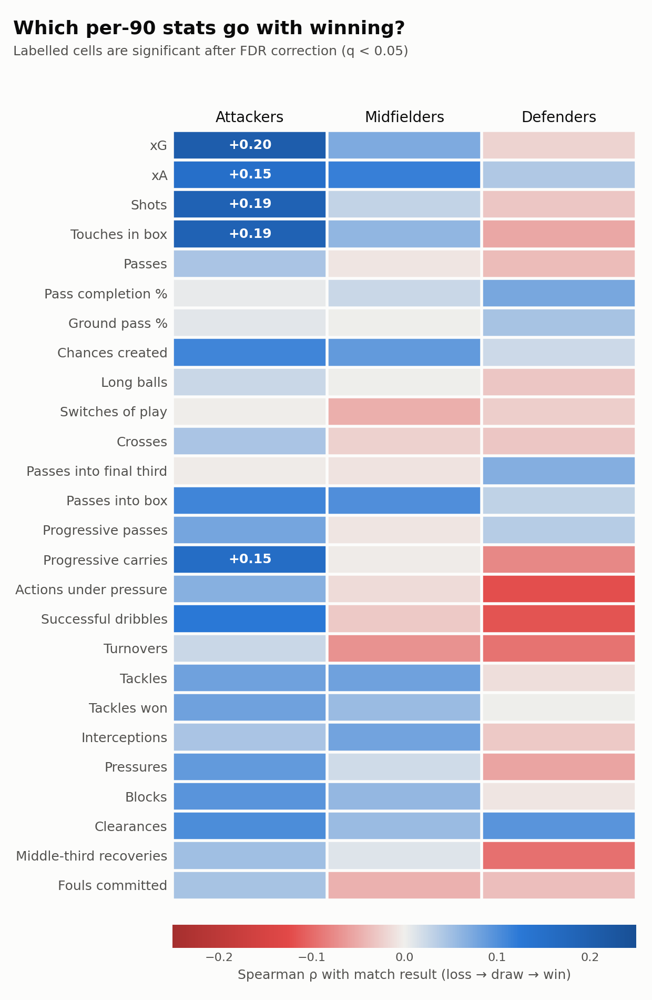
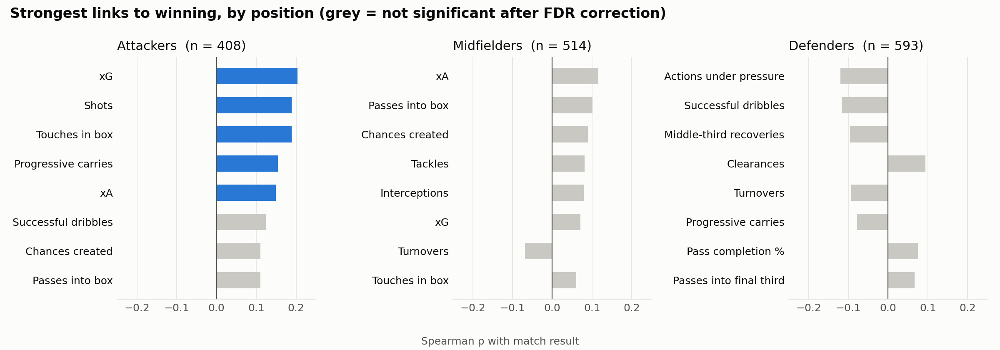

# What Wins World Cup Matches? Player Stats vs. Team Results (Qatar 2022)

An event-data analysis of all 64 matches of the 2022 FIFA World Cup. It asks a simple question:
**which individual player stats actually move with the team winning, and does the answer depend on position?**



## Key findings

- **For attackers, getting into the box is what goes with winning.** xG (ρ = +0.20), shots (+0.19) and touches in the box (+0.19)
  are the strongest, along with progressive carries (+0.15) and xA (+0.15). These are all statistically significant after
  correcting for multiple comparisons. The median attacker on a winning team produced **0.17 xG per 90** vs **0.06** on a losing team.
- **No single midfielder or defender stat significantly predicts the result.** The top midfield signals (xA, passes into the box,
  chances created) point the right way but don't survive correction. Team success there is spread across the unit,
  not visible in one player's box score.
- **Pass completion % is essentially unrelated to winning** for every position (|ρ| < 0.08). Keeping the ball tidy is not the same as hurting the opponent.
- **Defenders on losing teams are *busier*:** more actions under pressure, dribbles and middle-third recoveries
  (not significant, but consistent). That's likely a game-state effect: the side that's losing pushes up and plays more of the ball.



## Data

[StatsBomb Open Data](https://github.com/statsbomb/open-data) via [`statsbombpy`](https://github.com/statsbomb/statsbombpy):
every on-ball and off-ball event (~234k) plus lineups for the 2022 World Cup (competition 43, season 106).

## Method

1. **One row per player per match** (1,643 rows after filtering). Each row holds 26 metrics covering shooting,
   chance creation, passing, ball progression, ball retention and defending (see [`features.py`](worldcup_stats/features.py)).
2. **Minutes played** are reconstructed from lineup data, including stoppage and extra time. The primary position is the one played longest.
   Players with < 30 minutes are dropped, and all count stats are converted to **per-90 rates** so subs and starters are comparable.
3. **Target:** team result as an ordinal variable (loss = 0, draw = 0.5, win = 1). Knockout games decided on penalties count as draws,
   and **shootout kicks are excluded** from all shot/xG stats.
4. Players are grouped into **attackers, midfielders and defenders** (goalkeepers excluded).
5. **Spearman rank correlation** between each metric and the result within each group, with **Benjamini-Hochberg FDR correction**
   (q < 0.05) across the 26 tests per group.

### Limitations

- Correlation, not causation. Some metrics are driven by game state (a team that's ahead defends deeper), not the reverse.
- Players in the same match share an outcome, so rows aren't fully independent. p-values are somewhat optimistic.
- One tournament, 64 matches. The effects are modest (|ρ| ≤ 0.2) and should be checked against other competitions.

## Run it yourself

```bash
python -m venv .venv && source .venv/bin/activate
pip install -r requirements.txt
python run.py
```

The first run downloads and caches the event data (~40 s, ~220 MB in `data/cache/`). It writes:

| Output | Contents |
|---|---|
| `results/player_match_stats.csv` | The full player-match dataset (per-90 metrics, minutes, position, result) |
| `results/correlations.csv` | ρ, raw and FDR-adjusted p-values, and n for every metric × position group |
| `results/winners_vs_losers_medians.csv` | Median per-90 value of each metric for winning vs losing teams |
| `figures/*.png` | The charts above |

## Project structure

```
worldcup_stats/
  data.py       # StatsBomb loading with on-disk cache
  features.py   # event → player-match metrics, minutes played, per-90 conversion
  analysis.py   # Spearman correlations + FDR correction, winner/loser medians
  plots.py      # heatmap and bar charts
run.py          # end-to-end pipeline
```

## Acknowledgements

Data provided by [StatsBomb](https://statsbomb.com/) through their free Open Data release.
