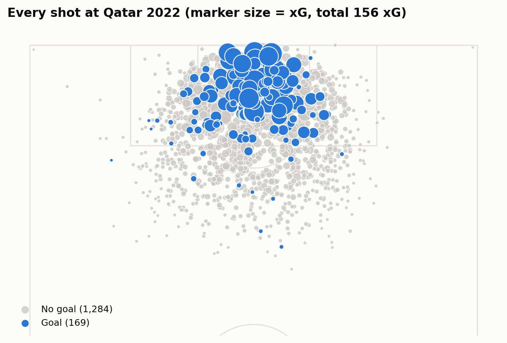
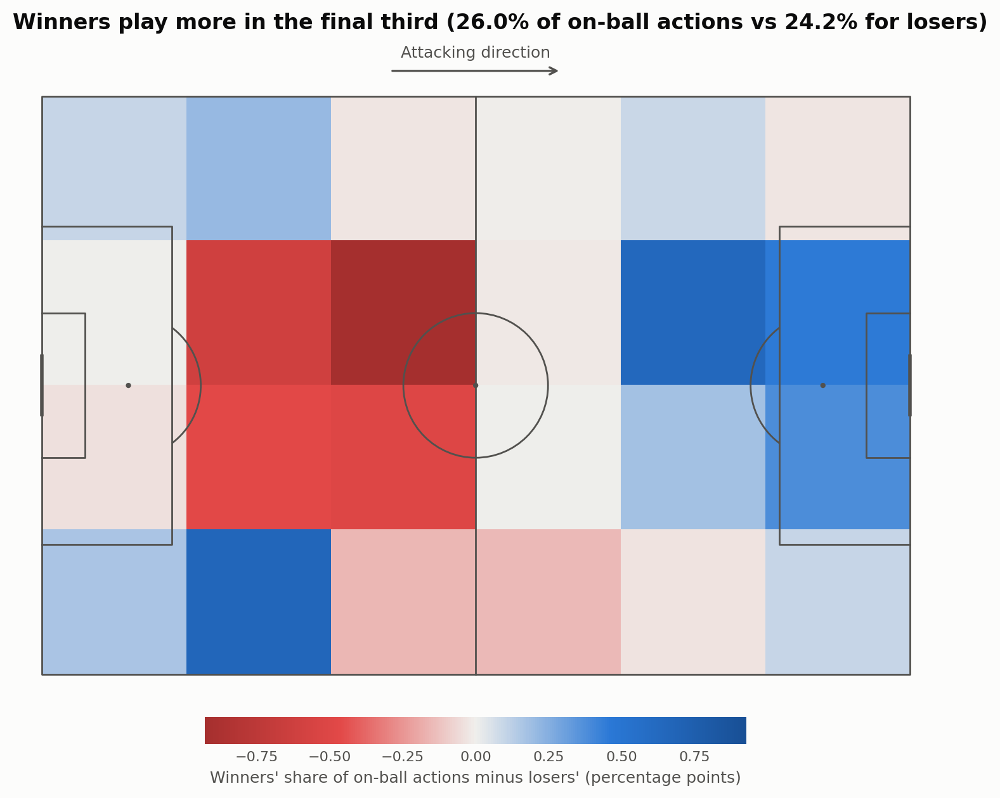
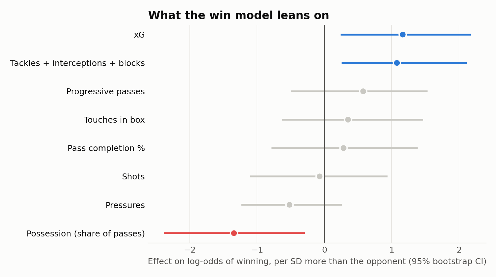

# What Wins World Cup Matches? Player Stats vs. Team Results (Qatar 2022)

**▶ [Explore the interactive site](https://smyans.github.io/world-cup-2022-player-stats/)**

An event-data analysis of all 64 matches of the 2022 FIFA World Cup. It asks a simple question:
**which stats actually move with winning, and does the answer depend on position?** It has three parts:

1. **Player stats vs. results:** correlations for 26 per-90 metrics, by position group, with multiple-comparison correction.
2. **Pitch views:** every shot of the tournament, and where winning vs losing teams have the ball.
3. **A win model:** a logistic regression that calls the winner from in-game stat differences, scored on matches it never saw.


## Key findings

- **For attackers, getting into the box is what goes with winning.** xG (ρ = +0.20), shots (+0.19) and touches in the box (+0.19)
  are the strongest, along with progressive carries (+0.15) and xA (+0.15). These are all statistically significant after
  correcting for multiple comparisons. The median attacker on a winning team produced **0.17 xG per 90** vs **0.06** on a losing team.
- **No single midfielder or defender stat significantly predicts the result.** Team success there is spread across the unit,
  not visible in one player's box score.
- **Pass completion % is essentially unrelated to winning** for every position (|ρ| < 0.08).
- **Winners play further up the pitch.** They make 26.0% of their on-ball actions in the final third vs 24.2% for losers.
  Losers spend more time on the ball in their own central midfield.
- **The win model calls 69% of decisive matches correctly** on held-out matches, vs 65% for xG difference alone and 50% for a coin flip.
  Out-xG-ing and out-defending the opponent both help. **Having more of the ball is the one stat that clearly *hurts***: Japan beat both
  Spain and Germany with under 27% of the passes.

| Shot map | Where winners have the ball |
|---|---|
|  |  |



## Data

[StatsBomb Open Data](https://github.com/statsbomb/open-data) via [`statsbombpy`](https://github.com/statsbomb/statsbombpy):
234,637 events plus lineups for the 2022 World Cup (competition 43, season 106).

## Method

**Player analysis** ([`features.py`](worldcup_stats/features.py), [`analysis.py`](worldcup_stats/analysis.py))
1. One row per player per match (1,643 rows) with 26 metrics covering shooting, chance creation, passing, progression, ball retention and defending.
2. Minutes played are reconstructed from lineup data, including stoppage and extra time. The primary position is the one played longest.
   Players with < 30 minutes are dropped, and count stats are converted to per-90 rates.
3. Target: team result (loss = 0, draw = 0.5, win = 1). Penalty-shootout kicks are excluded everywhere.
4. Spearman correlation per position group (attackers, midfielders, defenders), with Benjamini–Hochberg FDR correction (q < 0.05).

**Pitch views** ([`pitch.py`](worldcup_stats/pitch.py)): every non-shootout shot with its StatsBomb xG. Each team's on-ball actions are binned
into 20×20-yard zones and averaged over winning and losing teams in the 49 decisive matches.

**Win model** ([`model.py`](worldcup_stats/model.py))
- Each decisive match becomes two rows, one from each team's view, with eight features: the team-minus-opponent difference in xG, shots,
  touches in the box, share of passes, pass completion, progressive passes, pressures, and tackles + interceptions + blocks.
- The model is a logistic regression with no intercept on standardised features, so P(A beats B) + P(B beats A) = 1.
- It's scored with **leave-one-match-out cross-validation**: both rows of a match are always held out together.
  Coefficient uncertainty comes from a 1,000-sample bootstrap over matches.

### Limitations

- Correlation, not causation. In-game stats are partly *caused* by the score: a team that's behind chases the game and gets more of the ball.
- Players in the same match share an outcome, so player-level rows aren't fully independent.
- One tournament: 64 matches, 49 with a winner. Effects are modest and should be checked against other competitions.

## Run it yourself

```bash
python -m venv .venv && source .venv/bin/activate
pip install -r requirements.txt
python run.py
python -m http.server -d docs   # then open http://localhost:8000
```

The first run downloads and caches the event data (~40 s, ~220 MB in `data/cache/`). Everything in `results/`, `figures/` and
`docs/data/site.json` is regenerated on each run.

## Project structure

```
worldcup_stats/
  data.py       # StatsBomb loading with on-disk cache
  features.py   # event → player-match metrics, minutes played, per-90 conversion
  analysis.py   # Spearman correlations + FDR correction
  pitch.py      # shot table, zone-by-zone touch shares
  model.py      # team-match table, logistic regression, cross-validation, bootstrap
  plots.py      # static charts (matplotlib + mplsoccer)
  export.py     # JSON for the interactive site
run.py          # end-to-end pipeline
docs/           # the interactive site (plain HTML/CSS/JS + SVG, served by GitHub Pages)
```

## Acknowledgements

Data provided by [StatsBomb](https://statsbomb.com/) through their free Open Data release.
